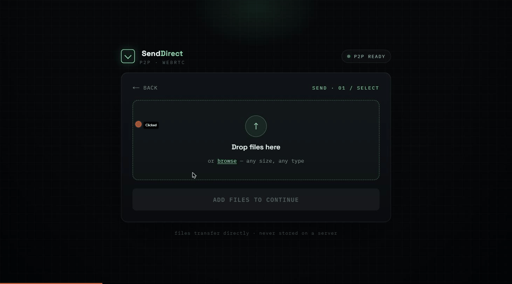
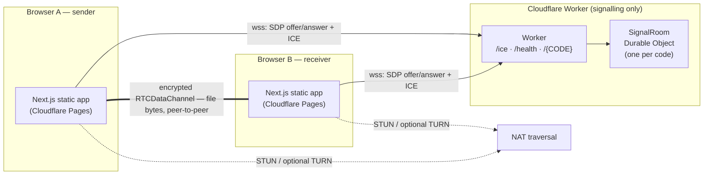
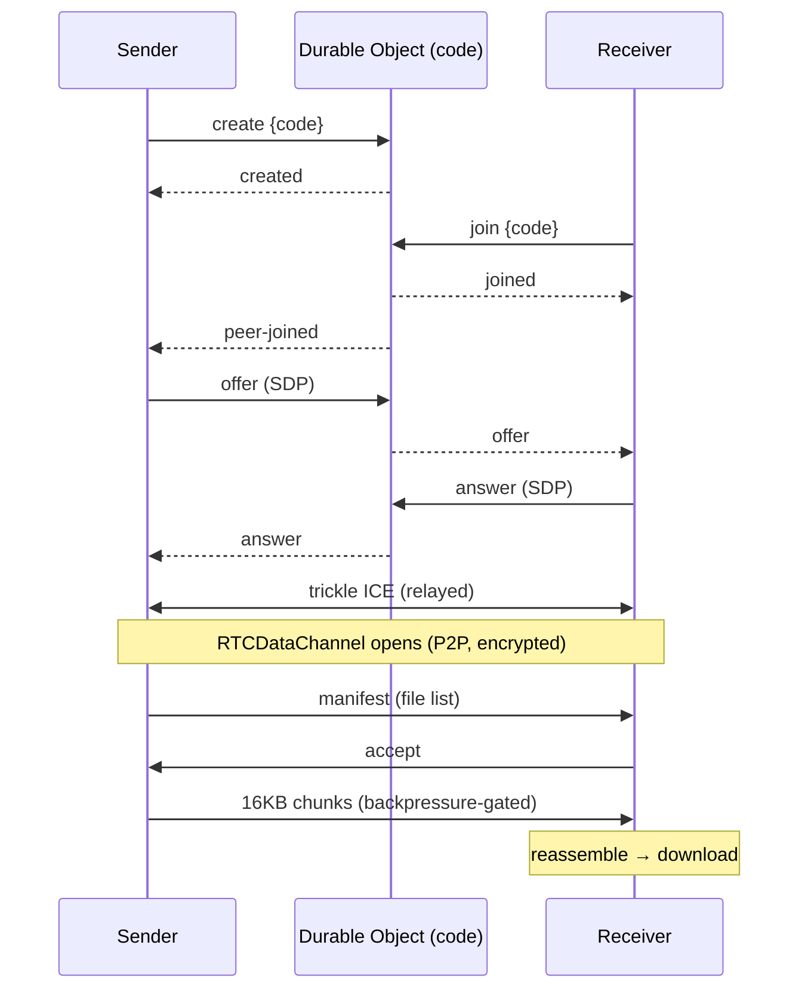

# SendDirect

**Browser-to-browser peer-to-peer file sharing over real WebRTC.** Files travel directly from one
browser to another across an encrypted `RTCDataChannel` — never uploaded to or stored on a server.
The backend does **signalling only** (relaying the WebRTC handshake); file bytes never touch it.

🔗 **Live:** https://send-direct.pages.dev &nbsp;·&nbsp; 📐 **Design notes:** [DESIGN.md](./DESIGN.md)



---

## Architecture



Only signalling (a few KB of SDP/ICE JSON) crosses Cloudflare. Every byte of every file goes
**directly between the two browsers** over a DTLS-encrypted data channel.

### Transfer sequence



---

## Repo layout

```
send-direct/
├── web/         Next.js (App Router, TS strict, Tailwind v4) — static-exported UI
└── server-cf/   Cloudflare Worker + SignalRoom Durable Object — signalling relay
```

## How it works

- **Signalling:** each 6-char code maps to one **Durable Object** (`SignalRoom`) that holds the two
  WebSocket peers and relays `offer`/`answer`/`ICE` between them. It uses the **WebSocket Hibernation
  API**, so idle rooms stop consuming duration while peers transfer.
- **Transfer:** sender opens an ordered `RTCDataChannel`, sends a JSON manifest, waits for `accept`,
  then streams each file in 16 KiB chunks gated by `bufferedAmount` (backpressure). The receiver
  verifies each file's byte count against the manifest before declaring success.
- **Large files:** transfers ≥ 64 MB stream to disk via the File System Access API (directory
  picker); smaller files download as a `Blob`.
- **NAT traversal:** public STUN by default; TURN is optional (see below).
- **Deep links / QR:** the share link `…/r?c=CODE` opens the receive flow with the code prefilled;
  the QR encodes that link.

See **[DESIGN.md](./DESIGN.md)** for the *why* behind each decision (interview-grade rationale).

## Running locally

```bash
# Terminal 1 — signalling Worker + Durable Object (port 8787)
cd server-cf && npm install && npx wrangler dev

# Terminal 2 — web app (port 3000)
cd web && npm install && cp .env.example .env.local && npm run dev
```

Open two windows at <http://localhost:3000>, Send in one, open the share link in the other.

## Testing

```bash
cd web && npm test         # Vitest: code/format helpers + zod schemas (33 tests)
cd server-cf && npm test   # Vitest: zod schemas + Workers-pool integration test (12 tests)
```

The Worker suite uses **`@cloudflare/vitest-pool-workers`** to run the real Worker + Durable Object
in-process and drive the full two-peer signalling flow (create → join → peer-joined → offer relay)
over actual WebSockets, plus `/health` and `/ice`.

Each package also has `npm run check` (typecheck + lint + prettier).

## TURN (optional)

Direct P2P works for the large majority of networks via STUN. Symmetric/strict NATs (some mobile
carriers, locked-down corporate networks) need a **TURN relay**. The integration is already built:
the Worker's `/ice` endpoint mints short-lived **Cloudflare TURN** credentials and the web app
fetches them before connecting — it just stays dormant (STUN-only) until you provide the key.

To enable it:

1. Cloudflare dashboard → **Realtime → TURN → Create** (free tier: 1,000 GB/month).
2. ```bash
   cd server-cf
   echo "<turn-key-id>"    | npx wrangler secret put TURN_KEY_ID
   echo "<turn-api-token>" | npx wrangler secret put TURN_KEY_API_TOKEN
   npx wrangler deploy
   ```

It's left optional because most connections succeed on STUN, and TURN relays carry file bytes (so
they cost bandwidth) — worth enabling only when you need guaranteed reach.

## Deploy (Cloudflare)

```bash
cd server-cf && npx wrangler deploy
cd web && NEXT_PUBLIC_SIGNAL_URL=wss://<your-worker>.workers.dev npm run build
npx wrangler pages deploy out --project-name send-direct --branch main
```

Set `ALLOWED_ORIGINS` in `server-cf/wrangler.toml` to your Pages origin and redeploy the Worker.

## Tech

- **Web:** Next.js 16 (App Router, static export), TypeScript (strict, no `any`/`unknown`), Tailwind
  v4, shadcn-style `Button` (cva), zustand state machine, zod, `react-qr-code`, sonner. WebRTC lives
  behind a small factory-function transport layer in `src/lib/webrtc/`.
- **server-cf:** Cloudflare Worker + `SignalRoom` Durable Object (hibernation + alarm TTL), per-IP
  rate-limit binding, `/ice` TURN-minting endpoint, zod-validated protocol.

## Limitations

- Small files reassemble in memory before download (large files stream to disk via File System
  Access). True end-to-end flow control to disk would need a receiver→sender pacing protocol.
- Two peers per room (1:1 transfer by design).
- TURN is opt-in (see above).
